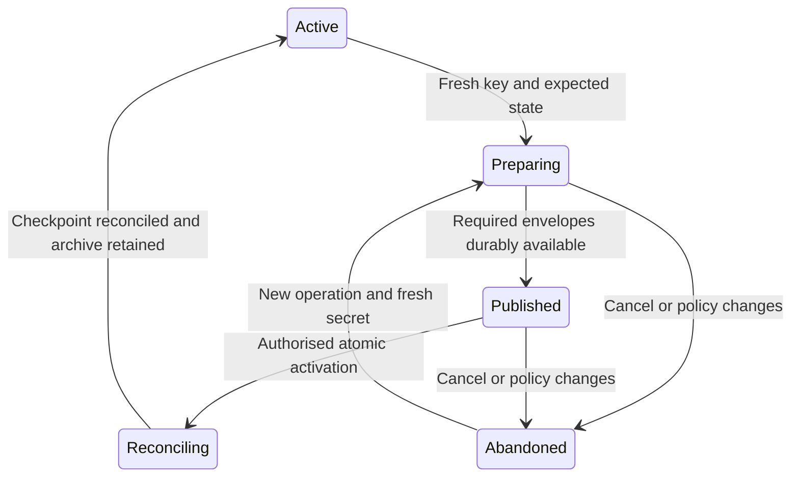

# Account viewing key sharing and recovery design plan

**Status:** Proposed design and validation plan, 19 October 2026. Protocol
encodings and the contract schema remain open decisions.

**Baseline:** Passport `6a1e5c631156a548ad06121928020d606e3fb605`, including the
merged [envelope experiment #177](https://github.com/midnightntwrk/passport/pull/177).

An account must remain readable when its original device is unavailable, when
its viewing key changes, and when a guardian quorum recovers control. This plan
proposes authenticated reader enrolment, resumable viewing-key rotation and a
single recovery-group recipient. Encryption remains client-side. Contract
changes should enforce the agreed lifecycle with the smallest necessary state.

The first implementation deliverable is a recovery-group experiment. Production
adoption depends on the decisions and acceptance criteria below. Record agreed
architectural choices in [ADRs](../adrs/0000-template.md), supported by review
and experiment evidence. Use the [existing MIP workflow](../mps-mip/README.md)
for amendments to custody, recovery and client specifications where behaviour
must be interoperable, before production adoption. Passport implementation
details and validation work remain in this plan and the component canvases.

## Scope and existing evidence

The [experiment](../../experiments/inbox-view-envelope/README.md) reuses the
opaque `Bytes<192>` inbox and existing authorised append and rotation calls.
Its [17 October evidence](../../contract/evidence/inbox-view-envelope/RESULTS.md)
demonstrates fresh-client restoration and accepted shielded spends before and
after rotation, offline-reader re-sealing, one live-coin backfill and exclusion
from a later viewing generation. It uses software ES256 credentials, synthetic
PRF outputs and empty stores in one process. It does not demonstrate a real
browser PRF journey, a dApp grant journey or guardian recovery.

The prototype has a trusted local reader roster and explicit bootstrap inputs.
Its generation numbers are test labels: the contract stores only the current
`enc_key`. Its format contains public P-256 device metadata and unallocated
experimental identifiers. Neither the format nor its 192-byte size is a
production compatibility promise.

This plan covers delivery of the account viewing secret and continuity of live
coin discovery. It does not introduce per-asset viewing restrictions, replace
account authorisation or promise complete archival transaction history.

## Conservative defaults for the next experiment

These defaults bound the recovery-group experiment on the existing contract.
They do not select a production schema or establish new on-chain guarantees.

| Area | Experiment default |
|---|---|
| Recovery status | Report envelope publication, chain activation, checkpoint reconciliation and successful recovery testing separately. Record the generation last tested for each recovery path. |
| Old viewing generations | Keep an encrypted recovery archive of every experiment generation and its transition journal. No automatic deletion after a timeout or completed backfill. |
| Guardian availability | Validate group-key derivation through an actual-quorum setup drill, then publish fresh envelopes while guardians remain offline. Do not require an acknowledgement on every rotation. |
| Successor access | Before submitting recovery, publish an authenticated, encrypted successor bundle outside the owner-only inbox. Test retrieval by a fresh successor after an independent caller finalises at the earliest allowed time. |
| Manifest availability | Use content-addressed encrypted records and two independently retrievable copies. Lose the original client and withhold the primary indexer; require retrieval through the remaining path or an explicit unavailable result. |

The retention, successor-bundle and retrieval rules below define what those
defaults require. D1 to D6 remain decisions for review and supporting evidence.

## Roles and authority

| Role | Authority and relationship to viewing access |
|---|---|
| Enrolled account device | Can authorise account operations. A separate reader capability supplies viewing access. |
| dApp or connected wallet | Uses its own key under an account-issued scoped grant. A separate approval delivers viewing access; connection does not enrol an account device. |
| Viewing reader | Can decrypt the account data encrypted to the generations it learns. It gains no signing or spending authority from an envelope. |
| Guardian group | Reconstructs the recovery secret at the configured threshold. One derived group reader key delivers viewing access to that quorum. |
| WaaS backup owner | If explicitly enrolled as an account owner, holds account-control authority. Its encryption capability and delivery policy must be specified separately. A provider acting only as a connected wallet remains a grantee. |

Sharing a viewing key grants the visibility that key permits, even if the
recipient's spending grant is restricted to one asset. The consent screen must
describe these independently. Revoking a spending grant does not erase viewing
keys. Excluding a reader while leaving it account-control authority is not a
security boundary against that owner changing the account again.

## Threat model and security rules

Assume hostile inbox records, a stale or withholding indexer, substituted
reader advertisements, stolen local caches, an excluded reader retaining every
old key, concurrent owners and crashes after any transaction. A compromised
authorised owner can deliberately disclose secrets or damage recovery; this
protocol does not remove that existing authority. Availability requires the
chain history and the specified recovery and bootstrap material to remain
obtainable.

| Rule | Required behaviour |
|---|---|
| V1 Separate authority | Reader enrolment, device enrolment and grant issuance are separately authorised acts, even when one user journey performs all three. |
| V2 Authenticate recipients | Bind each reader key to its role, account, network, profile and enrolment revision. Neither an inbox record nor successful AEAD decryption authenticates its publisher. |
| V3 Bind envelopes | Authenticate the protocol version, account, network, recipient key/profile, viewing generation and public key, and recovery session where applicable. Reject unsupported profiles and ambiguous encodings. |
| V4 Select from current state | Validate a restored secret against the current public viewing key and generation from authenticated chain state. Historical reads require an explicitly authenticated historical generation. |
| V5 Use fresh secrets | Every rotation uses fresh random viewing material. Increasing a generation counter does not make reuse of an old key safe. Generation counters must not wrap. |
| V6 Validate recovery paths | The policy must retain an owner or quorum path; dApp readers alone are insufficient. Proposed contract checks authenticate declared policy and publication commitments. Decryptability, independent retrieval and recovery testing are client obligations, with the tested generation recorded. Activation alone must not be presented as a usable backup or completed coin synchronisation. |
| V7 Revoke prospectively | Excluded readers retain old keys and data. Publication of a staged envelope already reveals the candidate secret to its recipient, even before activation. |
| V8 Preserve the quorum | Recovery-group delivery must require the existing reconstruction threshold. No ordinary per-guardian envelope may replace that threshold. |
| V9 Keep secrets local | Viewing secrets, reader secrets, PRF outputs and reconstructed recovery secrets must not enter contract witnesses, remote prover requests, logs or telemetry. Clear transient secret buffers where the runtime permits; do not claim guaranteed erasure from a browser heap. |
| V10 Make retries safe | Bind updates to an expected state and a unique operation identifier. Retries discover accepted work before resubmission; stale operations cannot replace a newer policy or generation. |

Authenticated chain state means state validated by the client or obtained via
an explicitly trusted chain provider. An arbitrary indexer response alone is
not a freshness proof. The client must expose an unavailable or stale-state
failure rather than silently treating a cached generation as current.

## Proposed protocol data

These are logical records for review, not allocated ledger fields or a wire
encoding. Exact encodings, sizes, domain strings and version negotiation require
cryptographic review and test vectors. Existing cryptographic preimages must
not change silently to accommodate this protocol.

| Record | Required information |
|---|---|
| Active viewing state | Protocol version, monotonic generation, current viewing public key, reader-policy revision and commitment. |
| Reader enrolment | Reader encryption public key, role/profile, context binding, consent/provenance, possession confirmation and lifecycle status. A grant reader also binds its grant identity and existing `read_pk_hash`. |
| Rotation manifest | Operation identifier, expected active state, proposed generation/public key, exact retained recipient policy, envelope references and hashes, active recovery-session binding and live-coin checkpoint policy. |
| Viewing envelope | Authenticated context plus encrypted viewing secret; profile-specific public metadata is separately validated. P-256 registration coordinates are not a universal payload requirement. |
| Recovery recipient | Recovery session and recovery authorisation-key binding, versioned group reader public key and corresponding viewing-envelope references. |
| Bootstrap descriptor | Account/network, contract capability, reader profile, credential selection and RP/origin information where applicable, and a trusted way to obtain current state. No viewing secret. |

Prefer a compact chain commitment to an authenticated manifest over publishing
a full reader directory. A commitment does not make the manifest available.
Its transport, confidentiality and reconstruction by another authorised owner
or recovering quorum must be settled before adopting this option. A roster
stored only on the original device is insufficient. A roster encrypted under a
key unavailable until that same roster is found creates a bootstrap cycle.

**Experiment retrieval target:** address the encrypted manifest by its content
hash and retain two copies with independent retrieval paths. The bootstrap
descriptor must let a fresh owner or quorum find, authenticate and decrypt it
without the original device or its cache. In the compact-commitment design,
the current chain revision authenticates the expected hash; the existing-schema
experiment must document its authenticated publication provenance instead.
Content addressing supplies integrity, not freshness or availability.

Disable the original client, withhold the primary indexer and one copy, and
retrieve the manifest, envelope references and transition journal through the
remaining path and a separate trusted chain-state source. Record which services
remain trusted, their failure domains, and a declared retrieval deadline for
the run. Missing data yields `recovery_data_unavailable`; stale or incorrectly
bound data yields `recovery_data_invalid`. Neither result permits fallback to
an unverified older policy or a successful-recovery indication. This is a
bounded availability test, not a guarantee against every custodian withholding.

A public roster can reveal device, provider and recovery relationships. Even
the prototype's changing recipient tags are identifiable by someone who knows
the reader public key. Record counts, timing and account association remain
visible. Privacy and availability are part of the manifest design decision.

## Reader enrolment and restoration

1. The recipient creates a reader key using the selected profile. For a
   passkey, PRF-derived encryption material remains separate from its signing
   key. ES256 support alone does not establish PRF support.
2. The recipient presents a request bound to the account, network, profile,
   reader public key, nonce and expiry. The owner authenticates the intended
   recipient through the connection/enrolment ceremony. A self-signed request
   by an unknown key is insufficient identity evidence. Demonstrate reader-key
   possession with a bound decrypt-and-confirm challenge before completion.
3. The owner approves the visibility and role, updates the authenticated
   policy, and publishes an envelope for the current generation. For a dApp,
   reuse and verify the grant's signed `read_pk_hash` binding rather than
   inventing an unrelated recipient identity. A read flag alone is not evidence
   that key delivery completed.
4. The recipient retrieves and decrypts the published envelope, checks the
   current public key and policy, and confirms receipt. Device/grant enrolment,
   publication and confirmation have distinct pending/completed states. A
   failed delivery must not be displayed as a usable backup.

Before re-sealing to a grant-associated reader, check the grant's current
liveness and the current reader policy. Continuing read-only access after a
grant expires or is revoked requires a separately authorised reader policy;
it must not happen through a stale roster entry.

A fresh client obtains the bootstrap descriptor independently of the old
client, validates current chain state, selects its credential/profile, and
scans the available envelope records with bounded, resumable pagination. It
skips malformed, unsupported, stale or poisoned candidates without accepting
substituted signing metadata. After opening a valid envelope it reconstructs
live coins and validates their current status. Spending still requires its own
live device entry or grant.

Specify recovery of account address, credential selection and signing-use
counters independently. The prototype's bounded 4,096-counter search is not a
solution for an arbitrarily long-used device. RP/origin changes and passkey
provider changes require explicit profile migration; they cannot silently
derive a different reader key and call it a restored backup.

## Rotation and reader exclusion

The proposed state machine is:

`Preparing` and `Published` may initially be client/manifest states. The
contract options below determine which transitions become enforceable on
chain. Activation changes the authoritative viewing state; completion also
requires checkpoint reconciliation. The retained archive supports later
old-generation receipts; returning to `Active` does not authorise key deletion.
After activation, repair moves forward rather than restoring an earlier
viewing key.

| Transition | Preconditions and failure behaviour |
|---|---|
| Prepare | Read authenticated current state and complete reader policy. Choose a fresh secret, next generation and operation identifier. Snapshot recovery-session binding and a chain checkpoint for coin discovery. |
| Publish | Seal to each retained reader, including the active recovery group when recovery is configured. Persist exact ciphertext references and hashes. Retries reuse the exact saved ciphertext; new sealing uses fresh ephemeral material and nonces under the chosen profile. |
| Activate | Check the proposed contract predicate and the separate client preflight below. Commit the new viewing key and required control commitments atomically. Competing or stale proposals fail and must reconcile. Chain success does not certify recovery. |
| Reconcile | Process the checkpointed coin set and receipts across activation. Resume from durable checkpoints and report the checkpoint reached. Keep the encrypted archive and continue scanning for later receipts; a completed scan does not permit pruning old keys. |
| Exclude | Remove the reader from the next policy and rotate to a fresh secret. Separately revoke device or grant authority where intended. If that reader received the staged secret, abandon that candidate and generate another. |

Publication is disclosure. Cancelling an operation cannot retract its staged
key, and the honest client's refusal to select a staged key does not stop a
recipient decrypting it. Restaging after a recipient/policy change must use
fresh material. Accepted duplicate records may cost space but must not change
the meaning of the operation.

**Experiment retention policy:** backfill descriptions of unspent coins to the
new generation, and keep every experiment viewing secret and its authenticated
transition journal in an encrypted recovery archive. Before activation, test
archive retrieval independently of the rotating client's local store. Limit
archive decryption to explicitly authorised owner/quorum recovery paths; new
dApp readers receive no historical keys through ordinary viewing-key delivery.
Historical access requires separate consent. Before retiring the old group,
obtain that consent and provision authenticated archive access for its
replacement, or retain another explicitly authorised historical recovery path.

There is **no automatic deletion cutoff** in this experiment. Completing a
checkpointed scan, observing no new receipts for a period, or finalising recovery
does not permit discarding an old secret or its discovery journal. A fresh
recovering client retrieves the archive and authenticated generation history,
resumes discovery, and can backfill late receipts under the current generation.
Use only test accounts and retain their encrypted archive for the experiment's
recovery lifetime; deliberate teardown ends that account's recovery guarantee.

The run must record its chain checkpoint/finality rule, coin-identity
deduplication and spent-coin filtering. Submit a valid old-key deposit after a
scan is reported complete, then restore it using a fresh client and the archive.
The current `deposit_shielded` does not check the viewing generation, so no
well-formed receipt to a retained experiment key is excluded merely because
it arrived late. Malformed descriptions, coin/description mismatches and
encryption to keys never provisioned for that account remain outside the
recoverability guarantee. An archive does not eliminate chain-history or
storage availability requirements.

**Production decision D2:** choose an enforced admission cutoff for conforming
stale-generation deposits, a durable historical-key retention policy, or an
explicitly narrower late-receipt guarantee. Define fresh-client behaviour after
any permitted deletion. Checking a declared generation cannot itself prove
which key encrypted opaque bytes or that they describe the deposited coin.
Until that decision is validated, neither a finite tail scan nor the existing
one-coin backfill justifies old-key deletion. Old readers can still read later
receipts encrypted to keys they already know; exclusion applies to fresh
generations, not automatically to every deposit after a wall-clock time.

## Guardian recovery lifecycle

Use the [proposed group recipient](../../experiments/inbox-view-envelope/DISCUSSION.md#proposed-next-experiment-one-recovery-recipient-in-the-same-inbox)
as the next experiment. At guardian-session setup, derive a separate reader
secret from the reconstructed recovery secret using a recovery-specific domain
and canonical secret encoding. Authenticate the public key against the account,
network, recovery session and recovery authorisation key. Retain the public key
for future wrapping; follow the existing reconstruction and secret-erasure
rules for private material. Cross-protocol key derivation requires review.

Setup validation must establish that the registered reader public key derives
from the secret actually distributed to the guardians. A replacement session
intended to exclude the old quorum needs fresh recovery secret material as
well as a new session identifier and a fresh viewing generation.

On each viewing-key rotation, the owner encrypts to that public key without
the guardians or recovery secret being online. The quorum later reconstructs
the recovery secret, derives its reader key and restores the current viewing
generation and any required transition material. One group envelope preserves
the reconstruction threshold; individual guardian reader envelopes would not.

The setup drill must use reconstructed guardian shares, not a setup client's
retained copy of the secret. After setup, record the latest published generation
separately from the generation/session last restored by an actual quorum.
Offline re-sealing does not advance the latter. Requiring every guardian to
acknowledge every rotation would defeat the intended offline refresh.

A quorum can decrypt these envelopes as soon as it reconstructs its secret.
The recovery veto and timelock govern account-control transfer, not this
off-chain disclosure. Consent must explain that distinction.

| Event | Proposed behaviour |
|---|---|
| Recovery setup | Authenticate the group key and demonstrate quorum decryption before advertising the backup as usable. |
| Recovery-session replacement | Provision and validate the new group. Rotate the viewing secret to exclude the old group from future generations; merely replacing the recovery authorisation key does not revoke its current viewing access. |
| Recovery pending | Proposed conservative rule: pause new reader-policy changes and viewing-key activation, invalidate unfinished proposals, and preserve access to the current recovery material. Owner cancellation remains available under the recovery protocol. This restriction is new contract behaviour requiring review. |
| Before submission | For the existing-schema experiment, prepare and independently retrieve the encrypted successor bundle before `recover_submit` starts the veto window. This is an honest-client precondition, not an existing contract readiness check. |
| Finalisation | Preserve the existing authorisation/veto rules and retirement of old device entries. Invalidate old reader-policy proposals and recognise that the old recovery session no longer establishes current recovery authority. |
| Successor activation | The successor rotates the viewing key, chooses its reader policy and provisions a fresh guardian session or explicitly reports recovery as unconfigured. Do not automatically retain old device, dApp or recovery readers. |

Current `recover_finalise` increments the device epoch, clears old device
entries, installs a successor, changes `recovery_pk` and invalidates the
published recovery vector. Old grants become unusable through their epoch
checks. It does **not** rotate `enc_key` or refresh `recovery_wrap`; the old
session identifier also remains stored. Old ciphertext remains readable by
the old quorum. The current successor entry is Jubjub; restoring a passkey
owner additionally requires authorised enrolment or a separately specified
successor extension. See the [current contract](../../contract/contracts/account.compact).

**Experiment successor path:** publish an encrypted bundle for a separate,
authenticated successor reader key to the redundant retrieval paths before
`recover_submit`. Include the current viewing secret, authorised archive access
and transition journal references. Its authenticated descriptor binds the
account, network, recovery session and authority, expected device epoch,
successor device and reader keys, viewing generation/public key, and content
hash. Validate that binding against the accepted recovery submission and the
archived authenticated pre-finalisation chain state. A stored old session
identifier alone is not evidence of current recovery authority.

The quorum cannot use the owner-authorised inbox append before finalisation
when the old owner is unavailable. The experiment therefore uses external
encrypted publication with explicit recovery/successor authentication, not an
assumed owner signature. Document that experimental authentication transcript
and discovery path without changing the existing `recover_submit` challenge.
The descriptor and decryption path must survive independently of the original
client and the recovery vector invalidated by finalisation. Publication failure
stops the honest client before submission; the existing contract does not
enforce this precondition against another submitter.

After submission, stop the recovering client and let an independent caller
finalise at the earliest allowed time. A separately launched successor client,
given only its signing/reader credentials and public bootstrap inputs, must
retrieve the bundle, restore current and retained historical viewing access,
and resume authorised operations. It must not reuse recovered secrets or a
saved bundle from the stopped process. Check the bundle against current chain
state and reject a stale binding. The existing-schema positive run uses owners
that respect the proposed pause during recovery; a separate concurrent-rotation
case must detect a stale bundle. Enforcing that pause on chain remains D3.

**Production decision D4:** choose an on-chain binding/readiness rule for a
successor package or a validated post-finalisation access path. Permissionless
finalisation cannot depend on a recovering SDK's local checkpoint. Preserve
the recovery veto and authority rules while testing the chosen delivery path.

The interval from finalisation until a fresh viewing generation activates is
explicitly **continued old-reader visibility**. Record its start and end in the
experiment; if successor rotation never happens, the interval does not expire
automatically. Report account control restored separately from fresh-generation
reader exclusion. Even after rotation, previously learned keys still reveal
old-generation data and late receipts encrypted to those keys.

The existing symmetric `recovery_wrap` cannot be refreshed using only a public
reader key. Keep its versioned legacy meaning until an explicit compatibility
transition is selected. Moving those bytes into the inbox does not solve
offline-guardian refresh. If a legacy wrap becomes stale during a trial, the
client must report that path as stale rather than advertise both paths as
current backups.

## Contract boundary and deployment options

Today, authorised append shares the same opaque inbox used by permissionless
deposit records. Rotation simply replaces `enc_key`; it does
not enforce a reader roster, a viewing generation or recovery freshness.
Recovery-session publication rejects a pending recovery, but ordinary rotation
and device enrolment do not. These facts delimit the starting implementation.

The existing `auth_nonce` already protects owner calls against replay and
stale authorisations. A viewing generation adds semantic identification of
key material and its delivery policy across clients; it does not replace
that transaction-level defence.

| Option | Benefits | Limits |
|---|---|---|
| Existing schema plus client protocol | Fastest route to the recovery experiment; uses existing append and rotation. | Client discipline and verifiable operation provenance carry policy authentication, ordering and recovery coupling. Cannot claim new on-chain invariants. |
| New schema with compact commitments | Can bind generation, policy, recovery recipient and activation preconditions without exposing a full public directory. | Requires manifest availability, new circuits and migration. A hash does not prove correct encryption or recipient availability. |
| New schema with an on-chain reader directory | Directly enumerable public recipient state and enforceable roster changes. | Public relationship leakage, growing state and processing costs; still cannot establish ciphertext decryptability by inspection. |

**Recommendation for evaluation:** use the existing schema for the bounded
recovery experiment, and compare the two schema options against the acceptance
criteria before selecting a production design. Prefer compact commitments if
their bootstrap and availability obligations can be met.

Candidate shared contract operations are policy update, recovery-recipient
registration, and viewing-generation activation bound to expected prior state.
All owner signing arms must apply identical lifecycle checks. Review every
write path, including deposits, grant change entries, recovery cancellation
and finalisation. Keeping an old unrestricted `rotate_enc_key` alongside a
guarded activation call would bypass the proposed invariant.

### Activation checks and client validation

For the compact-commitment option, the **proposed on-chain activation
predicate** is the conjunction of these checks. It is a candidate for a new
contract, not functionality supplied by the existing rotation circuit:

1. A valid owner authorisation binds the entire transition, including the next
   viewing key, policy commitment, required recipient commitments and envelope
   references. Existing nonce and signing-arm checks still apply.
2. The expected viewing generation/key, policy revision, device epoch and
   recovery-session/authority binding equal current state. No recovery is
   pending under the proposed D3 rule.
3. The next generation is exactly the current generation plus one, without
   overflow. The approved policy declares at least one owner/quorum path and
   includes the active recovery recipient when recovery is configured.
4. Each required recipient commitment has an envelope reference in the
   authenticated manifest. Each referenced inbox record exists in this account
   and matches its committed ciphertext hash. Policy/manifest membership and
   context bindings must be verified, not accepted as unrelated hashes.
5. Install the approved next viewing state atomically; no legacy rotation path
   may bypass these checks.

Exact commitment encodings and membership proofs remain D1/D5 work. None of
these checks proves correct encryption, secret retention or off-chain manifest
availability. The generation counter also cannot establish cryptographic
freshness of a newly supplied secret. Those remain separate obligations.

**Client preflight and evidence:** authenticate the reader/group keys, validate
possession at enrolment, construct and validate the new envelopes, and retrieve
the manifest and encrypted archive independently of the local cache. Preserve
at least one owner/quorum recovery path and its discovery inputs. Test actual
decryption with a fresh client or reconstructed quorum at the appropriate
drill; do not represent offline recipients as having acknowledged a new key.
The experiment must label which checks are only performed by its clients.

| Reported state | Evidence and limit |
|---|---|
| Published for generation g | Required records can be retrieved and their authenticated hashes/bindings match. Recipient decryption is not certified. |
| Generation g active | Chain state confirms activation. This does not certify usable recovery or complete coin discovery. |
| Recovery tested at generation r and session s | An identified owner/quorum path restored and validated the secret from an independent client. A newer publication does not update this test result. |
| Reconciled through checkpoint h | The defined scan completed through h. Later old-generation receipts still require the retained archive. |
| Recovery unavailable or invalid | Retrieval or validation failed. Preserve the distinct chain/control status and require repair; never turn a retrieval timeout or decryption failure into a successful-backup indication. |

Require a negative case in which a correctly committed, present ciphertext
cannot be decrypted by the intended recipient. Structural activation checks
may pass; client recovery must fail explicitly and must not advance the tested
generation. This demonstrates the boundary instead of implying a recoverability
proof. Any stronger proof requirement is a separate cryptographic and cost
decision and must not expose secrets to a delegated prover.

### Deployment and migration

The [documented deployment model](components/C1-account-custody-contract.md)
fixes the ledger schema at deployment. Circuit maintenance is available only
where the maintenance authority remains usable; the normal deployment flow
[retires that authority](../../contract/README.md#the-maintenance-authority-sits-above-the-seam-so-the-last-wave-retires-it)
because it can bypass the custody gate. Adding fields therefore requires a
new account under this model. Do not retain a privileged maintenance key merely
to simplify this feature.

Inventory actual deployments before choosing migration. A new account needs
explicit asset transfer, name/account-discovery updates, new account-bound
reader derivations, guardian provisioning and grant re-authorisation. Old
grants and RP/origin bindings cannot simply be copied. Clients must distinguish
old and new capabilities, and legacy parsing must not silently downgrade a
new account's protocol. Exact version values remain unallocated.

## Acceptance criteria

These are implementation gates, not claims that the plan or experiment meets
them. Evidence must identify source versions, inputs and actual chain outcomes.

| ID | Required result |
|---|---|
| A1 Recipient authentication | Reject substituted reader keys, unrelated grant hashes, expired/replayed enrolments and possession responses for another account, network or operation. |
| A2 Independent restore | Restore with the original device unavailable and no saved envelope/coin cache. Demonstrate real browser PRF and a separate-client journey for each supported passkey profile; fail clearly for unsupported credentials. |
| A3 Envelope validation | Reject malformed versions, context mismatches, tampering, wrong recipients, stale/poisoned candidates and substituted signing metadata. Use independent known-answer vectors for the selected encoding and cryptographic profile. |
| A4 Rotation interruption | Interrupt after every publication and activation step; resume from another authorised client. Concurrent proposals, duplicate submissions, policy changes and excluded staged recipients cannot silently reuse or activate unsafe material. A committed but undecryptable envelope must never produce a successful-recovery indication. |
| A5 Coin continuity | Restore during reconciliation and spend pre-rotation live coins, receipts across activation and an old-key deposit submitted after checkpoint reconciliation completes. Use a fresh client and the retained encrypted archive, with deduplication, spent-coin filtering and recorded finality assumptions. No automatic key/journal deletion. |
| A6 Guardian continuity | Validate setup from reconstructed shares, rotate with guardians offline, then restore with an actual quorum. Reject substituted group keys and threshold-minus-one attempts; run the replacement matrix below and independently verify derivation/context vectors. Publication alone must not advance the last-tested generation/session. |
| A7 Recovery transition | Stop the recovering client after submission, let a third party finalise at the earliest allowed time, and restore using a fresh successor with credentials/public bootstrap only. Test cancellation, session replacement, stale/missing successor bundles and concurrent rotation. Record the interval until fresh-generation exclusion; old devices/grants must lose control as specified. |
| A8 Bootstrap and availability | Lose the original client/cache, withhold the primary indexer and one manifest copy, and retrieve the authenticated policy/archive through independent paths within the declared run deadline. All-copy withholding yields an explicit unavailable result; wrong hashes, revisions or bindings are invalid. No stale-policy fallback. |
| A9 Contract enforcement | For each changed signing arm and bypass path, regenerate keys and show accepted valid proofs and rejected invalid transitions at node admission. Distinguish structural acceptance of an undecryptable committed envelope from client recovery failure. Include the outstanding recovery-retirement cases in #73. |
| A10 Cost and migration | Measure per-reader and per-live-coin publication, proof time, full transactions, state growth and deployment waves against the existing 15,000-verifier-byte budget. Rehearse the selected legacy-wrap and account migration on test accounts. |
| A11 Secret handling | Inspect delegated-prover inputs, logs and persisted state. No plaintext viewing, reader, PRF or reconstructed recovery secrets cross the authorised client boundary. |

### Guardian replacement matrix

For A6, publish generation g to the old group, establish a replacement with
fresh recovery-secret material, then publish fresh generation g+1 only to the
new group. Test both quorums against both generations:

| Quorum | Generation g already disclosed to the old group | Fresh generation g+1 |
|---|---|---|
| Old quorum | Can still decrypt its retained ciphertext; no retroactive revocation claim. | Cannot decrypt from its old shares, envelopes or archive access. |
| New quorum | Can decrypt only if historical access was separately authorised and delivered; otherwise reject. | Can decrypt and match the authenticated current viewing public key. |

Use threshold-minus-one shares without a retained setup secret, and substitute
a different group public key at registration. Repeat binding negatives for
another account, network and recovery session. Record canonical derivation and
binding vectors and verify them independently of the main implementation.
These cases are regression evidence, not a replacement for cryptographic
analysis. Retiring old archive access requires fresh wrapping for later archive
updates: a previously disclosed archive key must not unlock g+1 through a
shared mutable archive, even if the direct group envelope excludes the old group.

## Decisions required before contract implementation

| Decision | Proposed starting point | Evidence needed to settle it |
|---|---|---|
| D1 Reader-policy storage | Evaluate a compact chain commitment with a content-addressed encrypted manifest and redundant retrieval. | Fresh owner/quorum retrieval after loss of the original client and withholding of the primary indexer/one copy, with a declared deadline and explicit unavailable/invalid results; current-revision authentication, privacy review and no bootstrap cycle. |
| D2 Live-coin continuity | Experiment: backfill live descriptions and retain every generation in an encrypted recovery archive, without automatic deletion. | Late receipts after completed scans and fresh-client archive recovery. Production must choose an admission cutoff or durable retention/narrower guarantee and specify what remains recoverable after any deletion. |
| D3 Recovery and rotation ordering | Pause policy/activation changes while recovery is pending; invalidate prior proposals. | Veto/cancellation liveness, ongoing deposit handling and all-arm enforcement. |
| D4 Successor provisioning | Experiment: publish an authenticated encrypted successor bundle outside the owner-only inbox before submission, with independent discovery/retrieval. | Earliest third-party finalisation while the recoverer is offline, then fresh successor restore; stale/missing bundle failures and a measured privacy interval. Production must choose an on-chain package binding or validated post-finalisation access path. |
| D5 Cryptographic profiles | Separate device, dApp and recovery profiles with shared context rules. | Reviewed derivations, canonical encodings, replay rules, vectors, identifier allocation and measured payload sizes. |
| D6 Contract and migration | Experiment on existing schema; choose production schema only after D1 to D5. | Deployment inventory, legacy `recovery_wrap` compatibility, client capability negotiation and migration rehearsal. |

Review should involve the custody-contract, SDK, recovery and cryptography
maintainers. Review of this plan should agree the proposed invariants and
follow-up work. Each architectural decision remains open until its supporting
evidence has been reviewed and the agreed choice recorded in an ADR.

## Delivery sequence and existing work

1. **Design review:** agree authority boundaries, security rules, state
   transitions to evaluate and acceptance criteria for the follow-up work.
2. **Recovery-group experiment:** authenticate the group recipient, rotate with
   guardians offline, perform quorum restore and exercise session replacement
   and finalisation. Keep experimental formats clearly versioned.
3. **Protocol reference implementation and decisions:** settle
   manifest/encoding/bootstrap, implement resumable enrolment and rotation,
   and run failure and real-PRF journeys. Assess contract options against those
   results and record agreed architectural choices in ADRs.
4. **Contract and SDK adoption:** relevant MIP and client specification
   amendments for interoperable behaviour, minimal contract change, all-arm
   proof/node validation, independent security review and a rehearsed migration
   before deployment.

Track the work through the existing scopes rather than treating #177 as their
completion: [view-key and indexer #23](https://github.com/midnightntwrk/passport/issues/23),
[dApp connection #29](https://github.com/midnightntwrk/passport/issues/29),
[passkey client #48](https://github.com/midnightntwrk/passport/issues/48),
[recovery coordination #71](https://github.com/midnightntwrk/passport/issues/71),
[recovery contract validation #73](https://github.com/midnightntwrk/passport/issues/73)
and [SDK integration #167](https://github.com/midnightntwrk/passport/issues/167).
The companion canvases are [C1](components/C1-account-custody-contract.md),
[C14](components/C14-total-loss-recovery-flow.md),
[C17](components/C17-view-key-indexer-sync.md) and
[C23](components/C23-dapp-connection-protocol.md).
