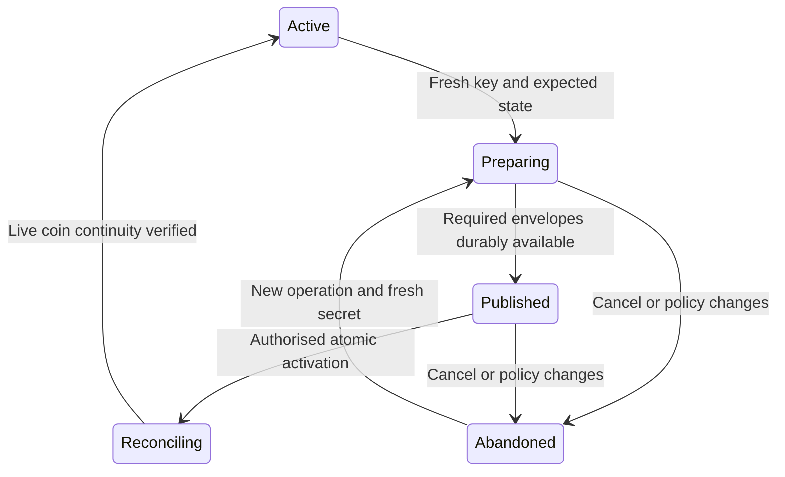

# Account viewing key sharing and recovery

**Status:** Draft for internal review, 19 October 2026. No production protocol,
wire identifiers or contract schema are approved by this RFC.

**Baseline:** Passport `6a1e5c631156a548ad06121928020d606e3fb605`, including the
merged [envelope experiment #177](https://github.com/midnightntwrk/passport/pull/177).

An account must remain readable when its original device is unavailable, when
its viewing key changes, and when a guardian quorum recovers control. This RFC
proposes authenticated reader enrolment, resumable viewing-key rotation and a
single recovery-group recipient. Encryption remains client-side. Contract
changes should enforce the agreed lifecycle with the smallest necessary state.

The first implementation deliverable is a recovery-group experiment. Production
adoption depends on the decisions and acceptance criteria below. An accepted
design should become an ADR and the relevant custody, recovery and client
specification amendments before a production contract change.

## Scope and existing evidence

The [experiment](../../experiments/inbox-view-envelope/README.md) reuses the
opaque `Bytes<192>` inbox and existing authorised append and rotation calls.
Its [17 October evidence](../../contract/evidence/inbox-view-envelope/RESULTS.md)
demonstrates fresh-client restoration and accepted shielded spends before and
after rotation, offline-reader re-sealing, one live-coin backfill and exclusion
from a later viewing generation. It uses software ES256 credentials, synthetic
PRF outputs and empty stores in one process. It does not demonstrate a real
browser PRF journey, a dApp grant journey or guardian recovery.

The prototype has a trusted local reader roster and explicit bootstrap inputs.
Its generation numbers are test labels: the contract stores only the current
`enc_key`. Its format contains public P-256 device metadata and unallocated
experimental identifiers. Neither the format nor its 192-byte size is a
production compatibility promise.

This RFC covers delivery of the account viewing secret and continuity of live
coin discovery. It does not introduce per-asset viewing restrictions, replace
account authorisation or promise complete archival transaction history.

## Roles and authority

| Role | Authority and relationship to viewing access |
|---|---|
| Enrolled account device | Can authorise account operations. A separate reader capability supplies viewing access. |
| dApp or connected wallet | Uses its own key under an account-issued scoped grant. A separate approval delivers viewing access; connection does not enrol an account device. |
| Viewing reader | Can decrypt the account data encrypted to the generations it learns. It gains no signing or spending authority from an envelope. |
| Guardian group | Reconstructs the recovery secret at the configured threshold. One derived group reader key delivers viewing access to that quorum. |
| WaaS backup owner | If explicitly enrolled as an account owner, holds account-control authority. Its encryption capability and delivery policy must be specified separately. A provider acting only as a connected wallet remains a grantee. |

Sharing a viewing key grants the visibility that key permits, even if the
recipient's spending grant is restricted to one asset. The consent screen must
describe these independently. Revoking a spending grant does not erase viewing
keys. Excluding a reader while leaving it account-control authority is not a
security boundary against that owner changing the account again.

## Threat model and security rules

Assume hostile inbox records, a stale or withholding indexer, substituted
reader advertisements, stolen local caches, an excluded reader retaining every
old key, concurrent owners and crashes after any transaction. A compromised
authorised owner can deliberately disclose secrets or damage recovery; this
protocol does not remove that existing authority. Availability requires the
chain history and the specified recovery and bootstrap material to remain
obtainable.

| Rule | Required behaviour |
|---|---|
| V1 Separate authority | Reader enrolment, device enrolment and grant issuance are separately authorised acts, even when one user journey performs all three. |
| V2 Authenticate recipients | Bind each reader key to its role, account, network, profile and enrolment revision. Neither an inbox record nor successful AEAD decryption authenticates its publisher. |
| V3 Bind envelopes | Authenticate the protocol version, account, network, recipient key/profile, viewing generation and public key, and recovery session where applicable. Reject unsupported profiles and ambiguous encodings. |
| V4 Select from current state | Validate a restored secret against the current public viewing key and generation from authenticated chain state. Historical reads require an explicitly authenticated historical generation. |
| V5 Use fresh secrets | Every rotation uses fresh random viewing material. Increasing a generation counter does not make reuse of an old key safe. Generation counters must not wrap. |
| V6 Preserve required readers | Retain at least one independently restorable owner or quorum path; a policy containing only dApp readers is insufficient. Honest clients may report rotation complete only after required reader and recovery envelopes are durably published and live-coin continuity is satisfied. Availability and ciphertext correctness are distinct obligations. |
| V7 Revoke prospectively | Excluded readers retain old keys and data. Publication of a staged envelope already reveals the candidate secret to its recipient, even before activation. |
| V8 Preserve the quorum | Recovery-group delivery must require the existing reconstruction threshold. No ordinary per-guardian envelope may replace that threshold. |
| V9 Keep secrets local | Viewing secrets, reader secrets, PRF outputs and reconstructed recovery secrets must not enter contract witnesses, remote prover requests, logs or telemetry. Clear transient secret buffers where the runtime permits; do not claim guaranteed erasure from a browser heap. |
| V10 Make retries safe | Bind updates to an expected state and a unique operation identifier. Retries discover accepted work before resubmission; stale operations cannot replace a newer policy or generation. |

Authenticated chain state means state validated by the client or obtained via
an explicitly trusted chain provider. An arbitrary indexer response alone is
not a freshness proof. The client must expose an unavailable or stale-state
failure rather than silently treating a cached generation as current.

## Proposed protocol data

These are logical records for review, not allocated ledger fields or a wire
encoding. Exact encodings, sizes, domain strings and version negotiation require
cryptographic review and test vectors. Existing cryptographic preimages must
not change silently to accommodate this protocol.

| Record | Required information |
|---|---|
| Active viewing state | Protocol version, monotonic generation, current viewing public key, reader-policy revision and commitment. |
| Reader enrolment | Reader encryption public key, role/profile, context binding, consent/provenance, possession confirmation and lifecycle status. A grant reader also binds its grant identity and existing `read_pk_hash`. |
| Rotation manifest | Operation identifier, expected active state, proposed generation/public key, exact retained recipient policy, envelope references and hashes, active recovery-session binding and live-coin checkpoint policy. |
| Viewing envelope | Authenticated context plus encrypted viewing secret; profile-specific public metadata is separately validated. P-256 registration coordinates are not a universal payload requirement. |
| Recovery recipient | Recovery session and recovery authorisation-key binding, versioned group reader public key and corresponding viewing-envelope references. |
| Bootstrap descriptor | Account/network, contract capability, reader profile, credential selection and RP/origin information where applicable, and a trusted way to obtain current state. No viewing secret. |

Prefer a compact chain commitment to an authenticated manifest over publishing
a full reader directory. A commitment does not make the manifest available.
Its transport, confidentiality and reconstruction by another authorised owner
or recovering quorum must be settled before adopting this option. A roster
stored only on the original device is insufficient. A roster encrypted under a
key unavailable until that same roster is found creates a bootstrap cycle.

A public roster can reveal device, provider and recovery relationships. Even
the prototype's changing recipient tags are identifiable by someone who knows
the reader public key. Record counts, timing and account association remain
visible. Privacy and availability are part of the manifest design decision.

## Reader enrolment and restoration

1. The recipient creates a reader key using the selected profile. For a
   passkey, PRF-derived encryption material remains separate from its signing
   key. ES256 support alone does not establish PRF support.
2. The recipient presents a request bound to the account, network, profile,
   reader public key, nonce and expiry. The owner authenticates the intended
   recipient through the connection/enrolment ceremony. A self-signed request
   by an unknown key is insufficient identity evidence. Demonstrate reader-key
   possession with a bound decrypt-and-confirm challenge before completion.
3. The owner approves the visibility and role, updates the authenticated
   policy, and publishes an envelope for the current generation. For a dApp,
   reuse and verify the grant's signed `read_pk_hash` binding rather than
   inventing an unrelated recipient identity. A read flag alone is not evidence
   that key delivery completed.
4. The recipient retrieves and decrypts the published envelope, checks the
   current public key and policy, and confirms receipt. Device/grant enrolment,
   publication and confirmation have distinct pending/completed states. A
   failed delivery must not be displayed as a usable backup.

Before re-sealing to a grant-associated reader, check the grant's current
liveness and the current reader policy. Continuing read-only access after a
grant expires or is revoked requires a separately authorised reader policy;
it must not happen through a stale roster entry.

A fresh client obtains the bootstrap descriptor independently of the old
client, validates current chain state, selects its credential/profile, and
scans the available envelope records with bounded, resumable pagination. It
skips malformed, unsupported, stale or poisoned candidates without accepting
substituted signing metadata. After opening a valid envelope it reconstructs
live coins and validates their current status. Spending still requires its own
live device entry or grant.

Specify recovery of account address, credential selection and signing-use
counters independently. The prototype's bounded 4,096-counter search is not a
solution for an arbitrarily long-used device. RP/origin changes and passkey
provider changes require explicit profile migration; they cannot silently
derive a different reader key and call it a restored backup.

## Rotation and reader exclusion

The proposed state machine is:

`Preparing` and `Published` may initially be client/manifest states. The
contract options below determine which transitions become enforceable on
chain. Activation changes the authoritative viewing state; completion also
requires reconciliation. After activation, repair moves forward rather than
restoring an earlier viewing key.

| Transition | Preconditions and failure behaviour |
|---|---|
| Prepare | Read authenticated current state and complete reader policy. Choose a fresh secret, next generation and operation identifier. Snapshot recovery-session binding and a chain checkpoint for coin discovery. |
| Publish | Seal to each retained reader, including the active recovery group when recovery is configured. Persist exact ciphertext references and hashes. Retries reuse the exact saved ciphertext; new sealing uses fresh ephemeral material and nonces under the chosen profile. |
| Activate | Recheck the expected generation, policy revision and recovery session, including a retained owner/quorum path that can restore from a fresh client. Commit the new viewing key and required control commitments atomically. Competing or stale proposals fail and must reconcile. |
| Reconcile | Process the pre-activation coin set and receipts arriving across the activation boundary. Resume from durable checkpoints. Mark completion only when the agreed live-coin continuity condition is met. |
| Exclude | Remove the reader from the next policy and rotate to a fresh secret. Separately revoke device or grant authority where intended. If that reader received the staged secret, abandon that candidate and generate another. |

Publication is disclosure. Cancelling an operation cannot retract its staged
key, and the honest client's refusal to select a staged key does not stop a
recipient decrypting it. Restaging after a recipient/policy change must use
fresh material. Accepted duplicate records may cost space but must not change
the meaning of the operation.

**Proposed first live-coin policy:** backfill descriptions of unspent coins to
the new generation rather than distributing all historical viewing secrets to
every new reader. Keep the previous secret and an authenticated transition
journal available through an authorised recovery path until reconciliation
finishes. A crash after activation must not leave the only old-key copy on the
lost device. Giving a recipient an old key reveals that generation's data and
requires separate consent.

The implementation must define a chain checkpoint/finality rule, deduplication
by coin identity, spent-coin filtering and a tail scan for concurrent receipts.
For conforming depositors, it must either reject deposits declaring a stale
generation/key at admission or provide a bounded late-receipt policy and an
archive/recovery path for their decryption. A declared key check does not prove
which key encrypted opaque bytes or that they describe the deposited coin;
malicious or malformed ciphertext is outside this recoverability guarantee. An
unbounded possibility of deposits to an old key prevents a finite claim that
the old key can safely be discarded. The existing one-coin backfill is not
evidence for this concurrent lifecycle. The current permissionless deposit
circuit does not reject a description encrypted to a stale viewing key.

## Guardian recovery lifecycle

Use the [proposed group recipient](../../experiments/inbox-view-envelope/DISCUSSION.md#proposed-next-experiment-one-recovery-recipient-in-the-same-inbox)
as the next experiment. At guardian-session setup, derive a separate reader
secret from the reconstructed recovery secret using a recovery-specific domain
and canonical secret encoding. Authenticate the public key against the account,
network, recovery session and recovery authorisation key. Retain the public key
for future wrapping; follow the existing reconstruction and secret-erasure
rules for private material. Cross-protocol key derivation requires review.

Setup validation must establish that the registered reader public key derives
from the secret actually distributed to the guardians. A replacement session
intended to exclude the old quorum needs fresh recovery secret material as
well as a new session identifier and a fresh viewing generation.

On each viewing-key rotation, the owner encrypts to that public key without
the guardians or recovery secret being online. The quorum later reconstructs
the recovery secret, derives its reader key and restores the current viewing
generation and any required transition material. One group envelope preserves
the reconstruction threshold; individual guardian reader envelopes would not.

A quorum can decrypt these envelopes as soon as it reconstructs its secret.
The recovery veto and timelock govern account-control transfer, not this
off-chain disclosure. Consent must explain that distinction.

| Event | Proposed behaviour |
|---|---|
| Recovery setup | Authenticate the group key and demonstrate quorum decryption before advertising the backup as usable. |
| Recovery-session replacement | Provision and validate the new group. Rotate the viewing secret to exclude the old group from future generations; merely replacing the recovery authorisation key does not revoke its current viewing access. |
| Recovery pending | Proposed conservative rule: pause new reader-policy changes and viewing-key activation, invalidate unfinished proposals, and preserve access to the current recovery material. Owner cancellation remains available under the recovery protocol. This restriction is new contract behaviour requiring review. |
| Before finalisation | The recovering client obtains the current viewing secret and required transition material, validates it against chain state, and durably prepares successor access. Viewing-key decryption does not authorise finalisation or shorten the veto window. |
| Finalisation | Preserve the existing authorisation/veto rules and retirement of old device entries. Invalidate old reader-policy proposals and recognise that the old recovery session no longer establishes current recovery authority. |
| Successor activation | The successor rotates the viewing key, chooses its reader policy and provisions a fresh guardian session or explicitly reports recovery as unconfigured. Do not automatically retain old device, dApp or recovery readers. |

Current `recover_finalise` increments the device epoch, clears old device
entries, installs a successor, changes `recovery_pk` and invalidates the
published recovery vector. Old grants become unusable through their epoch
checks. It does **not** rotate `enc_key` or refresh `recovery_wrap`; the old
session identifier also remains stored. Old ciphertext remains readable by
the old quorum. The current successor entry is Jubjub; restoring a passkey
owner additionally requires authorised enrolment or a separately specified
successor extension. See the [current contract](../../contract/contracts/account.compact).

Finalisation is permissionless after the veto window. A local SDK checkpoint
cannot force every finalising caller to wait for successor provisioning. The
design review must choose between a contract-bound successor package and a
resumable post-finalisation delivery path that remains available to the
legitimate successor. If viewing rotation follows finalisation, the interval
of continued old-reader visibility must be explicit. A prototype may measure
that interval; it must not claim atomic privacy revocation.

The existing symmetric `recovery_wrap` cannot be refreshed using only a public
reader key. Keep its versioned legacy meaning until an explicit compatibility
transition is selected. Moving those bytes into the inbox does not solve
offline-guardian refresh. If a legacy wrap becomes stale during a trial, the
client must report that path as stale rather than advertise both paths as
current backups.

## Contract boundary and deployment options

Today, authorised append shares the same opaque inbox used by permissionless
deposit records. Rotation simply replaces `enc_key`; it does
not enforce a reader roster, a viewing generation or recovery freshness.
Recovery-session publication rejects a pending recovery, but ordinary rotation
and device enrolment do not. These facts delimit the starting implementation.

The existing `auth_nonce` already protects owner calls against replay and
stale authorisations. A viewing generation adds semantic identification of
key material and its delivery policy across clients; it does not replace
that transaction-level defence.

| Option | Benefits | Limits |
|---|---|---|
| Existing schema plus client protocol | Fastest route to the recovery experiment; uses existing append and rotation. | Client discipline and verifiable operation provenance carry policy authentication, ordering and recovery coupling. Cannot claim new on-chain invariants. |
| New schema with compact commitments | Can bind generation, policy, recovery recipient and activation preconditions without exposing a full public directory. | Requires manifest availability, new circuits and migration. A hash does not prove correct encryption or recipient availability. |
| New schema with an on-chain reader directory | Directly enumerable public recipient state and enforceable roster changes. | Public relationship leakage, growing state and processing costs; still cannot establish ciphertext decryptability by inspection. |

**Recommendation for evaluation:** use the existing schema for the bounded
recovery experiment, and compare the two schema options against the acceptance
criteria before selecting a production design. Prefer compact commitments if
their bootstrap and availability obligations can be met.

Candidate shared contract operations are policy update, recovery-recipient
registration, and viewing-generation activation bound to expected prior state.
All owner signing arms must apply identical lifecycle checks. Review every
write path, including deposits, grant change entries, recovery cancellation
and finalisation. Keeping an old unrestricted `rotate_enc_key` alongside a
guarded activation call would bypass the proposed invariant.

The contract may validate authorisation, commitments, expected state and
presence of referenced records. It cannot infer that opaque ciphertext is
decryptable, the intended secret was encrypted, a reader retained its key, or
a private roster is available. The baseline proposal assigns those checks to
client validation and recovery drills. Any stronger proof requirement is a
separate cryptographic and cost decision; it must not expose secrets to a
delegated prover.

The [documented deployment model](../plans/components/C1-account-custody-contract.md)
fixes the ledger schema at deployment. Circuit maintenance is available only
where the maintenance authority remains usable; the normal deployment flow
[retires that authority](../../contract/README.md#the-maintenance-authority-sits-above-the-seam-so-the-last-wave-retires-it)
because it can bypass the custody gate. Adding fields therefore requires a
new account under this model. Do not retain a privileged maintenance key merely
to simplify this feature.

Inventory actual deployments before choosing migration. A new account needs
explicit asset transfer, name/account-discovery updates, new account-bound
reader derivations, guardian provisioning and grant re-authorisation. Old
grants and RP/origin bindings cannot simply be copied. Clients must distinguish
old and new capabilities, and legacy parsing must not silently downgrade a
new account's protocol. Exact version values remain unallocated.

## Acceptance criteria

These are implementation gates, not claims that the RFC or experiment meets
them. Evidence must identify source versions, inputs and actual chain outcomes.

| ID | Required result |
|---|---|
| A1 Recipient authentication | Reject substituted reader keys, unrelated grant hashes, expired/replayed enrolments and possession responses for another account, network or operation. |
| A2 Independent restore | Restore with the original device unavailable and no saved envelope/coin cache. Demonstrate real browser PRF and a separate-client journey for each supported passkey profile; fail clearly for unsupported credentials. |
| A3 Envelope validation | Reject malformed versions, context mismatches, tampering, wrong recipients, stale/poisoned candidates and substituted signing metadata. Use independent known-answer vectors for the selected encoding and cryptographic profile. |
| A4 Rotation interruption | Interrupt after every publication and activation step; resume from another authorised client. Concurrent proposals, duplicate submissions, policy changes and excluded staged recipients cannot silently reuse or activate unsafe material. |
| A5 Coin continuity | Restore and spend pre-rotation live coins and receipts around activation, with spent-coin deduplication, stale-key deposit cases and checkpoint/finality behaviour covered. Demonstrate recovery during reconciliation. |
| A6 Guardian continuity | Perform multiple rotations with guardians offline, then reconstruct with an actual quorum and restore current viewing access. Fewer than the threshold cannot restore it through their guardian material. |
| A7 Recovery transition | Exercise session replacement, pending/cancelled recovery, permissionless finalisation and successor reprovisioning. Old devices/grants lose control as specified; old readers are excluded only once a fresh generation takes effect. |
| A8 Bootstrap and availability | Lose the original roster cache. Reconstruct the authenticated policy and transition journal, distinguish unavailable from invalid data, reject rollback and handle a stale/withholding indexer. |
| A9 Contract enforcement | For each changed signing arm and bypass path, regenerate keys and show accepted valid proofs and rejected invalid transitions at node admission. Include the outstanding recovery-retirement cases in #73. |
| A10 Cost and migration | Measure per-reader and per-live-coin publication, proof time, full transactions, state growth and deployment waves against the existing 15,000-verifier-byte budget. Rehearse the selected legacy-wrap and account migration on test accounts. |
| A11 Secret handling | Inspect delegated-prover inputs, logs and persisted state. No plaintext viewing, reader, PRF or reconstructed recovery secrets cross the authorised client boundary. |

## Decisions required before contract implementation

| Decision | Proposed starting point | Evidence needed to settle it |
|---|---|---|
| D1 Reader-policy storage | Compact chain commitment with a durable authenticated manifest. | Fresh-owner and quorum reconstruction, privacy review, no bootstrap cycle, availability failure behaviour. |
| D2 Live-coin continuity | Backfill live descriptions, retain recovery-capable transition material until completion. | Concurrent/stale deposits, crash recovery, finite completion and an explicit historical-access policy. |
| D3 Recovery and rotation ordering | Pause policy/activation changes while recovery is pending; invalidate prior proposals. | Veto/cancellation liveness, ongoing deposit handling and all-arm enforcement. |
| D4 Successor provisioning | Bind successor access to recovery preparation or provide a resumable post-finalisation path. | Permissionless finalisation, no orphaned viewing secret, explicit interval before old-reader exclusion. |
| D5 Cryptographic profiles | Separate device, dApp and recovery profiles with shared context rules. | Reviewed derivations, canonical encodings, replay rules, vectors, identifier allocation and measured payload sizes. |
| D6 Contract and migration | Experiment on existing schema; choose production schema only after D1 to D5. | Deployment inventory, legacy `recovery_wrap` compatibility, client capability negotiation and migration rehearsal. |

Review should involve the custody-contract, SDK, recovery and cryptography
maintainers. Acceptance of this RFC selects the invariants and follow-up work;
it does not close these decisions without their listed evidence.

## Delivery sequence and existing work

1. **This RFC:** review authority boundaries, security rules, state transitions
   and acceptance criteria. Record accepted choices in an ADR as they settle.
2. **Recovery-group experiment:** authenticate the group recipient, rotate with
   guardians offline, perform quorum restore and exercise session replacement
   and finalisation. Keep experimental formats clearly versioned.
3. **Protocol reference implementation:** settle manifest/encoding/bootstrap,
   implement resumable enrolment and rotation, and run failure and real-PRF
   journeys. Assess contract options against those results.
4. **Contract and SDK adoption:** agreed spec amendments, minimal contract
   change, all-arm proof/node validation, independent security review and a
   rehearsed migration before deployment.

Track the work through the existing scopes rather than treating #177 as their
completion: [view-key and indexer #23](https://github.com/midnightntwrk/passport/issues/23),
[dApp connection #29](https://github.com/midnightntwrk/passport/issues/29),
[passkey client #48](https://github.com/midnightntwrk/passport/issues/48),
[recovery coordination #71](https://github.com/midnightntwrk/passport/issues/71),
[recovery contract validation #73](https://github.com/midnightntwrk/passport/issues/73)
and [SDK integration #167](https://github.com/midnightntwrk/passport/issues/167).
The companion canvases are [C1](../plans/components/C1-account-custody-contract.md),
[C14](../plans/components/C14-total-loss-recovery-flow.md),
[C17](../plans/components/C17-view-key-indexer-sync.md) and
[C23](../plans/components/C23-dapp-connection-protocol.md).
